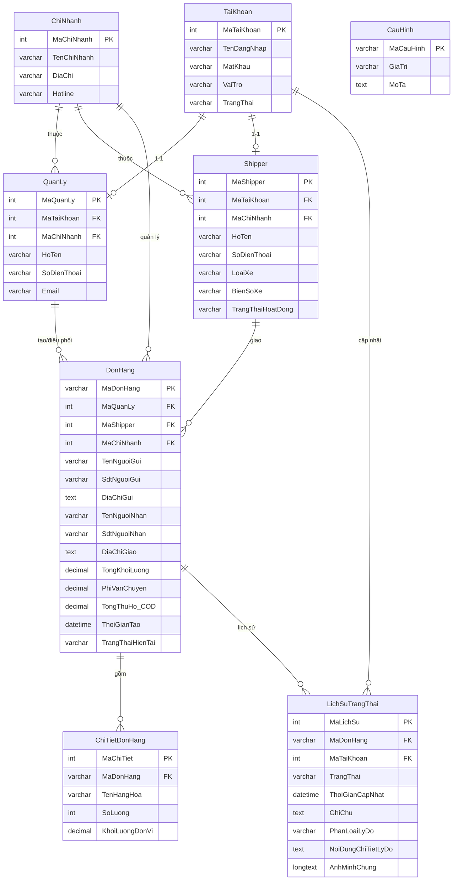

# Hệ Thống Quản Lý Vận Chuyển (Giao Nhanh Logistics)

Hệ thống quản lý vận chuyển gồm 3 phân hệ chính: **Quản lý (Admin)**, **Người vận chuyển (Shipper)** và **Tra cứu vận đơn công khai (Khách hàng)**, hỗ trợ tạo mã QR vận đơn, quét QR/nhập mã nhận hàng, chống xung đột nhận đơn (race condition) bằng khóa bi quan trên DB và lưu ảnh minh chứng giao hàng.

---

## 1. Kiến trúc & Công nghệ

- **Frontend:** React 19, Vite, Tailwind CSS v4, React Router, `qrcode.react`, `html5-qrcode`, `recharts` (`hethongvanchuyen-frontend/`)
- **Backend:** Java 17, Spring Boot 4, Spring Security + JWT, Spring Data JPA (`demo/`)
- **Database:** MySQL 8.0 (`db_giaonhanh_logistics`, schema khởi tạo trong [giaohang_db.sql](./giaohang_db.sql))
- **Triển khai:** Docker & Docker Compose (`mysql`, `backend`, `frontend` qua Nginx)

---

## 2. Thiết kế Cơ sở dữ liệu (ERD)

Cơ sở dữ liệu `db_giaonhanh_logistics` gồm **8 bảng**:



### Mô tả các bảng chính
| Bảng | Vai trò |
| :--- | :--- |
| `TaiKhoan` | Lưu thông tin đăng nhập, mật khẩu, phân quyền (`Admin`, `Shipper`) và trạng thái tài khoản. |
| `ChiNhanh` | Quản lý danh sách chi nhánh giao nhận (tên chi nhánh, địa chỉ, hotline). |
| `CauHinh` | Lưu tham số tính cước tự động (`PHI_CO_BAN`, `MOC_VUOT_CAN`, `PHI_VUOT_CAN_TREN_KG`). |
| `QuanLy` | Thông tin quản lý chi nhánh, liên kết 1-1 với `TaiKhoan` và N-1 với `ChiNhanh`. |
| `Shipper` | Hồ sơ người vận chuyển (họ tên, SĐT, loại xe, biển số xe, trạng thái `Đang rảnh` / `Đang giao` / `Đã khóa`). |
| `DonHang` | Thông tin vận đơn (người gửi/nhận, khối lượng, phí ship, COD, trạng thái hiện tại). |
| `ChiTietDonHang` | Danh sách các món hàng chi tiết bên trong một `DonHang` (tùy chọn khi tạo nhiều món). |
| `LichSuTrangThai` | Nhật ký thay đổi trạng thái đơn hàng, lý do thất bại (`PhanLoaiLyDo`, `NoiDungChiTietLyDo`) và `AnhMinhChung`. |

---

## 3. Tính năng chính

- **Quản lý (Admin):**
  - Tạo đơn hàng mới (có tùy chọn thêm chi tiết từng món hàng, tự động tính khối lượng & phí vận chuyển), tự sinh mã vận đơn và mã QR (hỗ trợ tải ảnh PNG / in nhãn).
  - Xem chi tiết, chỉnh sửa, phân công shipper đang rảnh, hủy đơn và theo dõi timeline lịch sử + ảnh minh chứng.
  - Quản lý danh sách Shipper (thêm/sửa/khóa/mở tài khoản), cấu hình bảng giá và xem báo cáo thống kê.
- **Người vận chuyển (Shipper):**
  - Nhận đơn `"Chờ lấy hàng"` (có khóa ghi `PESSIMISTIC_WRITE` chống tranh chấp khi nhiều shipper bấm nhận cùng lúc).
  - Đến cửa hàng quét mã QR (camera hoặc tải ảnh QR) hoặc nhập mã vận đơn thủ công để chuyển sang `"Đang giao"` (kiểm tra đúng shipper sở hữu đơn; nếu quá hạn giữ chỗ sẽ tự động trả đơn về `"Chờ lấy hàng"`).
  - Xác nhận `"Giao thành công"` (kèm upload ảnh minh chứng) hoặc `"Giao thất bại"` (bắt buộc chọn lý do, nhập lý do cụ thể và upload ảnh minh chứng).
- **Khách hàng:**
  - Tra cứu công khai trạng thái đơn hàng theo mã vận đơn kèm lịch sử cập nhật và ảnh minh chứng tại `/`.

---

## 4. Hướng dẫn cài đặt & chạy bằng Docker (Khuyên dùng)

Hệ thống đã đóng gói sẵn cả **3 container** (`mysql`, `backend`, `frontend`) trong [docker-compose.yml](./docker-compose.yml). Bạn **không cần** cài Node.js, Java hay chạy `npm run dev` / Spring Boot thủ công.

### Yêu cầu
- Cài đặt **Docker Desktop** (đảm bảo Docker đang chạy).
- Giải phóng các cổng sử dụng: `5173` (Frontend), `8080` (Backend) và `3308` (MySQL container). *(Nếu trước đó bạn đang bật Spring Boot trong IDE hoặc Vite ở cổng `8080`/`5173`, hãy tắt đi trước).*

### Bước 1: Khởi chạy toàn bộ hệ thống
Mở terminal tại thư mục gốc dự án (`HeThongVanChuyen`) và chạy:

```bash
docker compose up -d --build
```

*(Từ những lần chạy sau, chỉ cần chạy `docker compose up -d` hoặc bấm **Start** trong Docker Desktop).*

### Bước 2: Truy cập ứng dụng
- **Trang tra cứu khách hàng:** http://localhost:5173
- **Trang đăng nhập Admin / Shipper:** http://localhost:5173/login
- **Backend API:** http://localhost:8080
- **MySQL (kết nối từ máy host nếu cần xem DB):** `localhost:3308` | DB: `db_giaonhanh_logistics` | User: `root` | Pass: `root`

### Tài khoản demo mặc định (tự khởi tạo khi chạy Docker lần đầu)
| Vai trò | Tên đăng nhập | Mật khẩu |
| :--- | :--- | :--- |
| **Admin** | `admin1` | `123456` |
| **Shipper** | `shipper1` | `123456` |

### Lệnh quản lý Docker thường dùng
```bash
# Kiểm tra trạng thái các container
docker compose ps

# Xem log backend / frontend / mysql
docker compose logs -f backend

# Dừng hệ thống (vẫn giữ dữ liệu database)
docker compose down

# Dừng và xóa toàn bộ dữ liệu DB để khởi tạo lại từ đầu
docker compose down -v
```

---

## 5. Hướng dẫn chạy thủ công (Môi trường phát triển / không dùng Docker)

Nếu muốn chạy trực tiếp trên máy để phát triển:

### Yêu cầu
- **Java 17+**, **Maven**, **Node.js 18+**, **MySQL 8.0**

### Bước 1: Khởi tạo Database
Chạy script [giaohang_db.sql](./giaohang_db.sql) trên MySQL (port `3306`, user `root`, password `root` — hoặc chỉnh lại trong [application.properties](./demo/src/main/resources/application.properties)):
```bash
mysql -u root -p < giaohang_db.sql
```

### Bước 2: Chạy Backend (Spring Boot)
```bash
cd demo
./mvnw spring-boot:run
# Trên Windows PowerShell: .\mvnw.cmd spring-boot:run
```

### Bước 3: Chạy Frontend (React + Vite)
```bash
cd hethongvanchuyen-frontend
npm install
npm run dev
```
Truy cập tại http://localhost:5173.
